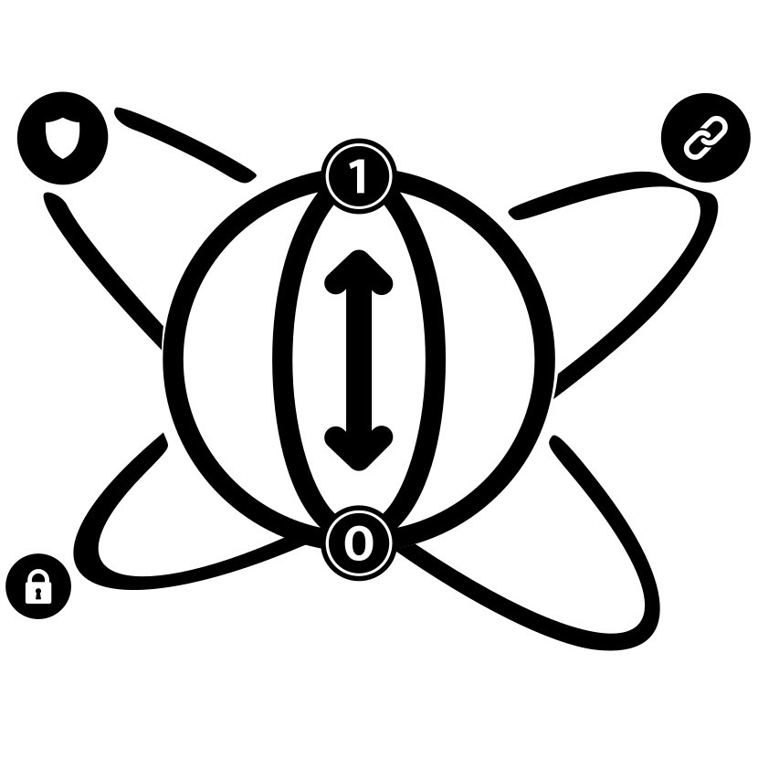

<p align="center">
  
</p>

<h1 align="center">qchain-docs</h1>

<p align="center">
  <b>The documentation of QChain: reports, the setup guide and the preliminary benchmarks.</b><br/>
  Everything about the project that isn't code: what was built and why, how to set it up, and the first post-quantum measurements.
</p>

<p align="center">
  
  
  
  
</p>

---

## 🌐 Live

| What | Link |
|------|------|
| **Project website** | **https://teamqchain.github.io** |
| **QChain API** | **https://qchain.tail4fff4b.ts.net/api/health** |

> The live system is a demo on a university VM: it may be offline at times. See
> [qchain-backend](https://github.com/teamqchain/qchain-backend) and
> [qchain-portal](https://github.com/teamqchain/qchain-portal).

---

## Overview

**QChain** is a post-quantum credential system, built as a University of Sharjah capstone project. Each credential
is signed with **ML-DSA-44 (CRYSTALS-Dilithium)** and anchored on a permissioned **Hyperledger Fabric** network whose
own identities are ML-DSA-44; the credential's attributes live only on **IPFS**, encrypted end-to-end to the
holder's **ML-KEM-768** key.

This repository holds the project's documents:

| Part | What it is |
|------|------------|
| `docs/setup.md` | the whole-system setup guide: prerequisites, the Fabric network, the database, IPFS, the backend, the apps and CI/CD |
| `docs/junior/` | the Junior-year deliverables (Spring 2026) as Markdown: team charter, literature review, progress reports 1 and 2, final report |
| `docs/senior/` | the Senior-year progress reports (Fall 2026) as Markdown |
| `algo-benchmarking/` | the first ML-DSA benchmarks, which came before the detailed study in [qchain-kpi](https://github.com/teamqchain/qchain-kpi) |
| `assets/` | the QChain logo and the benchmark graphs |

---

## Architecture

```
                         QChain, by repository
   ┌─────────────────────────────────────────────────────────────────────┐
   │  qchain-portal (web, Vercel)      qchain-wallet (mobile)            │
   │            └──── both use qchain-shared (certificate) ────┘          │
   │                                │ HTTPS                              │
   │                                ▼                                    │
   │  qchain-backend: Go API · MySQL schema · gateway · CI/CD · tests    │
   │                                │ Fabric Gateway                     │
   │                                ▼                                    │
   │  qchain-network: Hyperledger Fabric, ML-DSA-44 MSP, chaincode       │
   └─────────────────────────────────────────────────────────────────────┘
       qchain-docs (this repository)  ·  qchain-kpi (benchmarks)  ·  teamqchain.github.io (website)
```

---

## Preliminary benchmarks

`algo-benchmarking/` compares **ML-DSA-44, ML-DSA-65 and ML-DSA-87** across two Go implementations:

| Folder | Implementation |
|--------|----------------|
| `algo-benchmarking/go-bindings/` | **liboqs-go**, the C library through Go bindings (the one QChain uses) |
| `algo-benchmarking/go-native/` | a pure-Go implementation (Cloudflare CIRCL) |

Results and graphs: [algo-benchmarking/results.md](algo-benchmarking/results.md) and `assets/`. The detailed,
controlled study across three machines is in [qchain-kpi](https://github.com/teamqchain/qchain-kpi).

---

## Repository structure

```
qchain-docs/
├── docs/
│   ├── setup.md              # whole-system setup guide
│   ├── junior/               # team-charter, literature-review, progress-report-1/2, final-report
│   └── senior/               # progress-report-1, progress-report-2
├── algo-benchmarking/
│   ├── go-bindings/          # liboqs-go benchmark (Dockerfile, main.go, tests)
│   ├── go-native/            # pure-Go benchmark
│   ├── results.md            # numbers and graphs
│   └── sample_transcript.pdf # the sample document that was signed
├── assets/                   # qchain_logo.jpeg, benchmark graphs
└── LICENSE
```

---

## Getting started

### Read

Everything is Markdown and renders on GitHub. Start with `docs/setup.md` to stand the system up, or the reports in
`docs/junior/` and `docs/senior/` for the design and its history.

### Run the preliminary benchmarks

```bash
git clone https://github.com/teamqchain/qchain-docs.git
cd qchain-docs/algo-benchmarking
```

Then follow [algo-benchmarking/README.md](algo-benchmarking/README.md) (the liboqs-go benchmark runs in Docker).

---

## Related repositories

| Repository | What it holds |
|------------|---------------|
| [qchain-portal](https://github.com/teamqchain/qchain-portal) | QPortal, the web portal for issuers, verifiers and IT admins |
| [qchain-wallet](https://github.com/teamqchain/qchain-wallet) | QWallet, the holder's mobile app |
| [qchain-shared](https://github.com/teamqchain/qchain-shared) | the shared Flutter package: certificate template and viewer |
| [qchain-backend](https://github.com/teamqchain/qchain-backend) | the Go REST API, MySQL schema, gateway, CI/CD and end-to-end tests |
| [qchain-network](https://github.com/teamqchain/qchain-network) | the Hyperledger Fabric network with ML-DSA-44 identities, and the chaincode |
| [qchain-docs](https://github.com/teamqchain/qchain-docs) | this repository |
| [qchain-kpi](https://github.com/teamqchain/qchain-kpi) | the post-quantum performance benchmarks |
| [teamqchain.github.io](https://github.com/teamqchain/teamqchain.github.io) | the project website |

Some of these repositories are private.

---

## Team

A University of Sharjah capstone project, supervised by **Dr. Manar Abu Talib** and **Dr. Sohail Abbas**.

| Member | Role |
|--------|------|
| Mohammed Bin Ali Maqqavi ([@M0hd-Maqqavi](https://github.com/M0hd-Maqqavi)) | Project Manager |
| Mohammed Abdul Haris ([@mohammed-ah-14](https://github.com/mohammed-ah-14)) | Technical Lead |
| Mohammed Nihal ([@nihvp](https://github.com/nihvp)) | Quality Assurance Lead |
| Mohammed Obeid ([@MohammedObeid88](https://github.com/MohammedObeid88)) | Blockchain Specialist |

---

## License

**Proprietary — all rights reserved.** © 2026 QChain. This content is proprietary and confidential; unauthorized
copying, modification, distribution, or use is prohibited without prior written permission. See [LICENSE](LICENSE).

---

## Disclaimer

This is an academic research project. The reports describe the system as it was when each was written; the code
repositories above describe it as it is now. The preliminary benchmarks are exploratory; for controlled measurements
see qchain-kpi.
